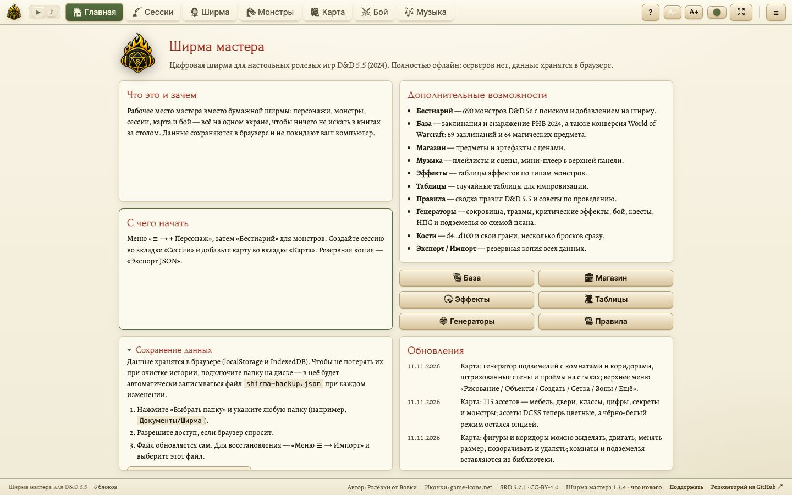

# Ширма мастера — D&D 5.5 (2024)

Локальный инструмент мастера для D&D 5-й редакции (2024). Работает офлайн, без сервера: данные хранятся в браузере и не покидают устройство.

**Демо:** https://chipsfirst.github.io/dm_screen/



## Что нового в 1.4.1

- **Главная**: интерактивный «Быстрый старт» из пяти шагов с прогрессом; пустые состояния ширмы и карты с подсказками и кнопками действий.
- **Меню ☰**: быстрые действия, библиотеки, вид, данные и помощь разведены по группам; сброс к демо-данным выделен как опасное действие.
- **Сессии**: панель редактора разгружена — отмена и повтор слева, вторичное форматирование в меню «Ещё».
- **Карта**: режимы «Подготовка / Игра», туман войны и зоны собраны в меню «Сцена», а «Создать» переименовано в «Наполнить».
- **Кубики**: отдельный дайс-трей в правом нижнем углу с быстрым выбором d4–d100.
- **Верхняя панель**: вкладки выровнены по центру, кнопки получили единый акцидентный шрифт.
- **Темы**: исправлены контраст и цветовые баги — особенно в «Пергаменте», Nord, Solarized, Monokai, Tokyo Night и One Dark.
- **Таймер**: отсчёт и секундомер, несколько именованных таймеров одновременно, сохранение между вкладками и сигнал будильника.
- **HUD «За столом»**: компактная полоса с текущим ходом, таймером, кубиками и состояниями.
- **Звук**: панель громкости и отдельная громкость сигнала таймера; звуков на клики и броски нет.
- **Избранное**: звёздочки и фильтр «только избранное» в бестиарии и библиотеке.
- **Проверка данных**: поиск битых связей, ссылок сессий и меток карт.
- **Музыка**: поиск по трекам.
- **Монстры**: кнопки «Из бестиария» и «Свой монстр» вместо двух похожих «добавить/создать».

## Что нового в 1.4.0

- **Карточки**: взаимные связи между блоками, шаблоны карточек и печать/PDF — карточка или статблок целиком.
- **Черты SRD 5.2.1**: 17 черт с русскими описаниями, отдельная категория в библиотеке и поиске.
- **Сессии**: свои шаблоны с советами и источниками, панель связанных карточек, ссылки `[[...]]` в тексте.
- **Карта**: отмена и повтор, калибровка сетки, гибкий туман войны, мультивыделение и слои, состояния на токенах, режим экрана игроков, маршрут с дистанцией и переходы «карточка ↔ карта».
- **Генераторы**: имена по девяти культурам и 54 готовых НПС и монстра из приключений.
- **Ассеты**: 247 тайлов — добавлены Kenney Tiny Dungeon/Tiny Town (CC0) и новые наборы DCSS.

## Что нового в 1.3.5

- **Бой**: компактный трекер — одна строка на участника, статусы в поповере, быстрая заметка над журналом и статблок монстра или персонажа в нижней панели.
- **Ширма и монстры**: 2–4 колонки, фильтр по карточкам, разделы «Персонажи / Заметки / Правила», режим списка, сводки в свёрнутых карточках и облегчённое оформление.
- **Музыка**: длительность каждого трека и общая, перетаскивание треков за ручку, строка воспроизведения с перемоткой и play/pause прямо в списке.
- **Бестиарий**: исправлены имена в статблоках World of Warcraft — вместо «вау» подставляются «Ледяная Скорбь», «Шлем Господства» и другие; у Артаса поправлены падежи.

## Что нового в 1.3.4

- **Карта**: генератор подземелий с комнатами и коридорами, штрихованные стены и проёмы в местах стыков.
- **Карта**: библиотека комнат и подземелий и 115 ассетов — мебель, двери, классы, цифры, секреты и монстры; ассеты DCSS теперь цветные.
- **Карта**: фигуры и коридоры можно выделять, двигать, менять размер, поворачивать и удалять; у комнат из библиотеки ручки доступны сразу.
- **Карта**: зоны AoE с размером в футах (5–240, шаг 5) и добавлением по кнопке; поворот зон Shift+перетаскиванием.
- **Карта**: верхнее меню «Рисование / Объекты / Создать / Сетка / Зоны / Ещё»; цветные метки, токены и ассеты, чёрно-белый режим — по желанию.

## Возможности

- **Ширма** — карточки персонажей, монстров, правил и заметок: 2–4 колонки, фильтр, разделы по типам, режим списка, сводки, взаимные связи, шаблоны, печать и PDF, импорт из JSON (в том числе карточек персонажей из Long Story Short).
- **Сессии** — редактор в стиле Obsidian: форматирование, картинки, автосохранение, шаблоны с советами, связанные карточки, экспорт в Markdown и PDF.
- **Карта** — несколько карт, генератор подземелий с комнатами и коридорами, библиотека комнат и 247 ассетов (мебель, двери, стены, природа, ловушки, магазины, монстры), токены с инициалами и ХП, цветные метки с подписями и заметками на ширме (наведите — виден текст заметки, клик — переход), режимы «Подготовка / Игра», редактирование фигур, сетка «гексы/квадраты» с привязкой, туман войны, отмена и калибровка сетки, слои и мультивыделение, состояния токенов, режим игроков, маршрут с дистанцией, зоны AoE, импорт/экспорт JSON и загрузка по URL.
- **Бой** — порядок по инициативе, раунды и «Следующий ход» (N), компактный трекер с быстрыми статусами, статблок монстра или персонажа в нижней панели, проверка концентрации с броском при уроне, степперы КД/ХП/урона, заметка и журнал боя, экспорт в Markdown.
- **Бестиарий** — 690 монстров по-русски: 510 редакции 2024, 96 из Curse of Strahd (Страд, Рахадин, Баба Лысага, вервороны, вистани) и 84 из конверсии World of Warcraft (Иллидан, Артас, Аллерия); типы, языки, иммунитеты, спасброски, действия, поиск (в том числе по тексту действий), постановка на карту.
- **Пресеты монстров** — 8 заготовок от миньона до босса плюс пустая карточка: КД, ХП, характеристики, приёмы; всё правится на месте.
- **База** — 391 заклинание PHB 2024 и 69 заклинаний World of Warcraft с русскими описаниями; названия выверены по переводу dungeons_ru / dnd.su («Лечение ран», «Волшебная стрела», «Мистический заряд»).
- **Магазин** — ~1360 позиций: снаряжение PHB, каталог по типам лавок с тремя ценами, магические предметы SRD 5.2.1, AU и World of Warcraft (Испепелитель, Ледяная Скорбь).
- **Музыка** — плейлисты и сцены: импорт своих аудиофайлов, длительность и общая длительность, перетаскивание треков, строка воспроизведения с перемоткой, мини-плеер в верхней панели, переключение треков с клавиатуры. Файлы лежат локально в IndexedDB и не попадают в резервную копию.
- **Правила DMG** — 14 конспектов разделов и 8 авторских таблиц; **SRD 5.2.1** — 260 предметов с механикой; **AU** — 33 заклинания и 52 предмета (индекс).
- **Правила и советы** — окно «Правила» с семью разделами правил 5.5: проверки, бой, отдых, состояния, магия, планирование, проведение; кнопка «Совет мастеру» — 30 случайных советов по вождению.
- **Черты** — 17 черт SRD 5.2.1 с описаниями, добавляются на ширму как карточки.
- **Генераторы** — имена по девяти культурам, 54 НПС и монстра из приключений, сокровища по полосам КР (клады и индивидуальная добыча), травмы d20, критические попадания и промахи, бой по бюджету опыта с фильтром по среде обитания и типу встречи, квесты, НПС с тремя деталями внешности, подземелья со схемой плана; любой результат добавляется на ширму.
- **Служебное** — глобальный поиск (Ctrl/⌘+K) по блокам, бестиарию, библиотеке и магазину с кнопкой «＋», Undo (Ctrl+Z), броски кубиков со всплывающим результатом, случайные таблицы с добавлением результата на ширму, автодополнение значений в полях карточки (стрелки, Enter), темы одним списком, компактные карточки на ширме.
- **Горячие клавиши** — Alt+1…7 по вкладкам, Alt+←/→, Ctrl+Alt+1…9 по картам, Ctrl+Space и Ctrl+Shift+←/→ для музыки, ? — окно со всеми сочетаниями.

## Запуск

- **Демо** — открыть ссылку выше.
- **Портативно** — `bash packaging/make_portable.sh`, затем запустить `start-macos.command` или `start-windows.bat` из архива: поднимется локальный сервер и откроется браузер.
- **Установщики** — `.dmg`, `.msi`, `.exe` в [релизах](https://github.com/chipsfirst/dm_screen/releases).
- **Вручную** — открыть `index.html` в браузере (часть функций с `file://` ограничена).

## Данные

Блоки, карты, сессии, бой и настройки — в `localStorage`; картинки и документы — в `IndexedDB`. Резервная копия (включая журнал боя и состояние раунда): «Меню ☰ → Экспорт» или автозапись `shirma-backup.json` в выбранную папку (Chrome/Edge).

Аудиофайлы музыки хранятся отдельно, в собственной базе `IndexedDB` (`shirma_audio_v1`), и в резервную копию не входят — копируйте их как обычные файлы. Плейлисты, громкость и повтор сохраняются в `localStorage`.

При переходе между версиями (`file://` ↔ `127.0.0.1` ↔ демо) данные не переносятся сами — используйте «Экспорт» → «Импорт».

## Сборка

```bash
bash packaging/pack_web.sh dist        # веб-файлы для Pages и Tauri
bash packaging/make_portable.sh        # портативный zip
```

Установщики собираются в GitHub Actions (`.github/workflows/build-installers.yml`): вручную через Actions → «Сборка и релиз» или пушем тега `v*` — тогда создаётся GitHub Release с файлами. Локальная сборка Tauri требует Rust и Node: `npm i -g @tauri-apps/cli@^2`, затем `tauri build` из `src-tauri/`.

Пересборка данных из исходных JSON — скрипты в `tools/data/` (`_build_*.py`, `_merge_bestiary.py`, `_translate_bestiary_ru.py`); исходники лежат в `data/`, готовые файлы попадают в `js/data/`. Подробности — `tools/README.md`.

Проверки перед релизом — `.github/workflows/checks.yml`: загрузка приложения в Node с DOM-заглушкой (`tests/check-app.mjs`) и аудит бестиария (`tools/data/_audit_bestiary.py --ci`). Локально: `node tests/check-app.mjs`, `python3 tools/data/_audit_bestiary.py --ci`.

## Структура

```
index.html            — точка входа: разметка и подключение скриптов
style.css             — оформление
manifest.json         — PWA-манифест
js/app/
  core/               — модель данных, IndexedDB, localStorage, undo, сохранение на диск
  ui/                 — рендер, темы, события, модалки, глобальный поиск
  data/               — правила, пресеты, бестиарий, SRD, магазин, библиотека
  media/              — музыка и карта
  pages/              — сессии и вкладка «Бой»
js/data/              — сгенерированные данные: бестиарий, библиотека, магазин, SRD, книги AU
js/icons.js           — реестр SVG-иконок
assets/               — логотипы, гекс, исходные SVG
vendor/               — локальные шрифты (Inter, PT Serif, Alegreya, Forum)
tools/data/           — python-сборщики данных и их кэш
packaging/            — сборка веб-файлов и портативной версии
src-tauri/            — проект Tauri (установщики)
tests/                — проверка загрузки приложения в Node
data/                 — исходники данных (JSON, Markdown)
.github/workflows/    — CI: релизы, демо на Pages, проверки
dist/, build/         — результаты сборки (в git не хранятся)
```

## Благодарности и лицензии

- Иконки — [game-icons.net](https://game-icons.net) (Lorc, Delapouite), **CC BY 3.0**.
- Шрифты — Inter, PT Serif, Alegreya, Forum с Google Fonts, **SIL OFL 1.1**; лежат в `vendor/fonts`.
- Магические предметы, классы, виды и предыстории — **SRD 5.2.1**, **CC-BY-4.0**.
- «Arcana Unleashed» и DMG — только индексы и конспекты своими словами; дословный текст книг не воспроизводится.
- D&D — товарный знак Wizards of the Coast; проект не аффилирован с WotC.

## Лицензия

Код — [MIT](LICENSE). Игровые тексты, названия и данные принадлежат их правообладателям и этой лицензией не покрываются.
